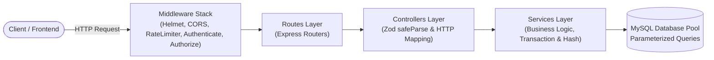
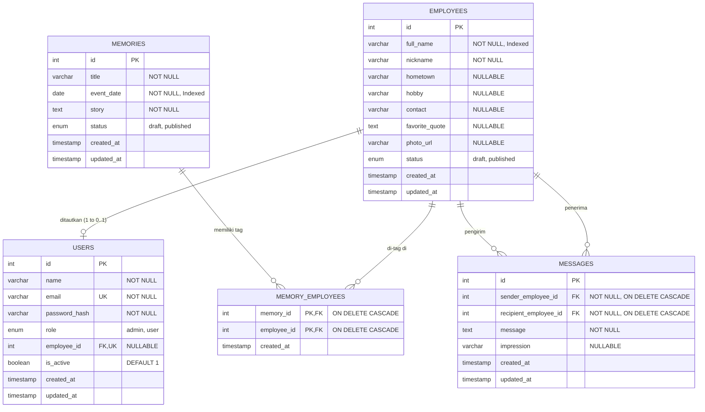

# 🏛️ Warga Halim — Backend API

> **RESTful Backend API untuk website kenangan perusahaan "Warga Halim".**  
> Dibangun dengan **Express 5**, **TypeScript**, **MySQL2**, dan **Zod** dengan arsitektur berlapis profesional, aman, dan teruji secara otomatis (*production-ready*).

---

## 📋 Daftar Isi

1. [Tentang Aplikasi Ini](#-tentang-aplikasi-ini)
2. [Technology Stack & Library](#-technology-stack--library)
3. [Arsitektur & Struktur Folder](#-arsitektur--struktur-folder)
4. [Skema Database & Relasi](#-skema-database--relasi)
5. [Daftar REST API](#-daftar-rest-api)
6. [Panduan Setup Project](#-panduan-setup-project)
7. [Cara Menjalankan Aplikasi](#-cara-menjalankan-aplikasi)
8. [Cara Menjalankan Pengujian (Testing)](#-cara-menjalankan-pengujian-testing)
9. [Standar Keamanan & Hardening](#-standar-keamanan--hardening)

---

## 📖 Tentang Aplikasi Ini

**Warga Halim** adalah platform web kenangan yang didedikasikan untuk mendokumentasikan memori bersama, profil para mantan karyawan, serta pesan dan kesan setelah perusahaan bubar.

### Karakteristik & Fitur Utama:
- **Tingkat Akses & Role Pengguna:**
  - **Pengunjung Publik (Belum Login):** Hanya dapat memeriksa status kesehatan server (`GET /api/health`) dan melakukan login (`POST /api/auth/login`).
  - **User Terautentikasi (Mantan Karyawan):** Mengakses data terbit (*published*), meliputi direktori karyawan, rincian kenangan bertanggal beserta karyawan yang ditandai, dan pesan/kesan antar karyawan.
  - **Administrator:** Mengelola seluruh data melalui Panel Admin: CRUD karyawan, upload foto dengan verifikasi *magic bytes*, CRUD kenangan berbalut transaksi MySQL, moderasi pesan, serta manajemen akun pengguna.
- **Moderasi Terpusat:** Pesan dan kesan dikelola sepenuhnya oleh admin (tambah dan hapus). Tidak disediakan fitur ubah (`PUT`/`PATCH`) maupun registrasi mandiri publik (akun dibuat oleh admin).
- **Format Respon Standar:** Seluruh respon API konsisten menggunakan struktur `{ success, data, message }`.

---

## 🛠️ Technology Stack & Library

| Kategori | Teknologi / Library | Versi | Alasan Pemilihan & Fungsi |
| :--- | :--- | :--- | :--- |
| **Runtime Environment** | [Node.js](https://nodejs.org/) | `>= 18.x` (disarankan 20+) | Lingkungan eksekusi JavaScript server-side dengan dukungan native fetch & ESM. |
| **Web Framework** | [Express](https://expressjs.com/) | `^5.2.1` | Minimalist web framework generasi terbaru dengan penanganan routing dan error async bawaan. |
| **Bahasa Pemrograman** | [TypeScript](https://www.typescriptlang.org/) | `^5.9.3` | *Strict static typing* untuk mencegah runtime error dan menjaga skalabilitas kode. |
| **Database Management** | [MySQL](https://www.mysql.com/) | `>= 8.0` | RDBMS andal untuk data relasional integritas tinggi (FK Cascading & Constraints). |
| **Database Driver** | [mysql2](https://github.com/sidorares/node-mysql2) | `^3.19.1` | Driver MySQL performa tinggi dengan *Connection Pooling* dan *Parameterized Query* (`?`). |
| **Validasi Skema** | [Zod](https://zod.dev/) | `^4.3.6` | Deklarasi skema tipe dan validasi payload request (body, query, params) yang *type-safe*. |
| **Keamanan & Enkripsi** | [bcryptjs](https://github.com/dcodeIO/bcrypt.js) | `^3.0.3` | Algoritma *hashing* satu arah yang aman dengan salt untuk password akun. |
| **Autentikasi** | [jsonwebtoken](https://github.com/auth0/node-jsonwebtoken) | `^9.0.3` | Pembuatan dan verifikasi token akses JWT (*Bearer*) berbasis algoritma `HS256`. |
| **Rate Limiter** | [express-rate-limit](https://github.com/express-rate-limit/express-rate-limit) | `^8.3.1` | Mitigasi serangan *brute-force* pada endpoint login (dibatasi 5 request/menit). |
| **Keamanan HTTP** | [helmet](https://helmetjs.github.io/) & [cors](https://github.com/expressjs/cors) | `^8.1.0` / `^2.8.5` | Proteksi header HTTP standar dan kontrol izin asal domain (*Cross-Origin Resource Sharing*). |
| **Media & File Upload** | [multer](https://github.com/expressjs/multer) | `^2.5.0` | Penanganan *multipart/form-data* dengan *in-memory storage* (buffer) berukuran maksimal 2 MB. |
| **Cloud Storage** | [@vercel/blob](https://vercel.com/docs/storage/vercel-blob) | `^2.9.0` | Penyimpanan CDN objek awan untuk foto profil karyawan dengan fallback lokal otomatis. |
| **Testing Framework** | [Vitest](https://vitest.dev/) & [Supertest](https://github.com/ladjs/supertest) | `^5.1.0` / `^7.2.0` | Pengujian integrasi REST API berkecepatan tinggi dengan assertions HTTP lengkap. |
| **Dev Tooling** | [tsx](https://github.com/privatenumber/tsx) & [dotenv](https://github.com/motdotla/dotenv) | `^4.21.0` / `^17.2.4` | Eksekutor TypeScript instan tanpa kompilasi manual dan pemuat variabel environment. |

---

## 🏗️ Arsitektur & Struktur Folder

Aplikasi dirancang dengan **Arsitektur Berlapis Bersih (*Clean Layered Architecture*)** yang memisahkan tanggung jawab secara tegas (*Separation of Concerns*):



### Pohon Direktori Lengkap (`server/`)

```text
server/
├── src/
│   ├── config/
│   │   └── env.ts                      # Validasi environment variables dengan Zod saat bootstrap
│   ├── controllers/                    # Mengatur HTTP request/response & mapping payload
│   │   ├── admin.employee.controller.ts
│   │   ├── admin.memory.controller.ts
│   │   ├── admin.message.controller.ts
│   │   ├── admin.user.controller.ts
│   │   ├── auth.controller.ts
│   │   ├── employee.controller.ts
│   │   ├── health.controller.ts
│   │   ├── memory.controller.ts
│   │   └── message.controller.ts
│   ├── db/
│   │   ├── pool.ts                     # MySQL2 Connection Pool (Serverless-safe connectionLimit)
│   │   ├── schema.sql                  # DDL skema 5 tabel basis data
│   │   ├── seed.sql                    # Data benih awal (demo employees, memories, messages)
│   │   └── seed-admin.ts               # Skrip inisialisasi akun Administrator dengan password aman
│   ├── middleware/
│   │   ├── authenticate.ts             # Verifikasi JWT token & sinkronisasi status aktif user
│   │   ├── authorize.ts                # Role-Based Access Control (RBAC) untuk admin
│   │   ├── error.middleware.ts         # Centralized error handler (400 JSON parse, 413, 409, 500)
│   │   ├── rateLimiter.ts              # Express-rate-limit konfigurabel untuk proteksi login
│   │   └── upload.middleware.ts        # Multer memoryStorage dengan batas ukuran 2 MB
│   ├── routes/                         # Definisi routing REST API
│   │   ├── admin.employee.route.ts
│   │   ├── admin.memory.route.ts
│   │   ├── admin.message.route.ts
│   │   ├── admin.user.route.ts
│   │   ├── auth.route.ts
│   │   ├── employee.route.ts
│   │   ├── health.route.ts
│   │   ├── memory.route.ts
│   │   ├── message.route.ts
│   │   └── index.ts                    # Agregator seluruh router (proteksi terpusat /admin)
│   ├── schemas/                        # Skema validasi Zod
│   │   ├── admin.employee.schema.ts
│   │   ├── admin.memory.schema.ts
│   │   ├── admin.message.schema.ts
│   │   ├── auth.schema.ts
│   │   ├── employee.schema.ts
│   │   └── memory.schema.ts
│   ├── services/                       # Logika bisnis inti & manipulasi data parameterized
│   │   ├── admin.employee.service.ts
│   │   ├── admin.memory.service.ts     # Manajemen transaksi MySQL atomik
│   │   ├── admin.message.service.ts
│   │   ├── admin.user.service.ts       # Penautan eksklusif employee_id & guard admin
│   │   └── auth.service.ts
│   ├── types/
│   │   └── express.d.ts                # TypeScript Request augmentation (req.user & req.file)
│   ├── utils/                          # Helper & utilities serbaguna
│   │   ├── avatar.ts                   # Generator inisial nama karyawan
│   │   ├── blob.ts                     # Verifikasi magic bytes (JPG/PNG/WebP) & Vercel Blob client
│   │   ├── crypt.ts                    # Enkripsi & verifikasi hash bcrypt
│   │   ├── errors.ts                   # Custom Error class (AdminServiceError)
│   │   ├── handleServiceError.ts       # Handler catch error terstandarisasi
│   │   └── response.ts                 # Formatter helper sendSuccess dan sendError
│   ├── app.ts                          # Perakitan Express app, middleware global, & security headers
│   └── server.ts                       # Server bootstrap & port listener
├── tests/                              # Test suite otomatis (Vitest + Supertest)
│   ├── setup.ts                        # Setup hook, database auto-reset, seed helpers
│   ├── health.test.ts
│   ├── public.test.ts
│   ├── auth.test.ts
│   ├── admin.employees.test.ts
│   ├── admin.memories.test.ts
│   ├── admin.messages.test.ts
│   ├── admin.users.test.ts
│   ├── admin.photo.test.ts
│   └── hardening.test.ts
├── package.json
├── tsconfig.json
├── vitest.config.ts
└── .env.example
```

---

## 🗄️ Skema Database & Relasi

Aplikasi menggunakan 5 tabel relasional dengan integritas data berbasis constraint database:



### Rincian Aturan & Constraint Kunci:
1. **`users.employee_id`:** Dibatasi unik (`UNIQUE`). Satu profil karyawan hanya boleh ditautkan ke maksimal 1 akun pengguna. Bila baris `employees` dihapus, kolom ini otomatis bernilai `NULL` (`ON DELETE SET NULL`), sehingga akun login pengguna tidak ikut terhapus.
2. **`memory_employees`:** Relasi *many-to-many* antara kenangan dan karyawan. Jika karyawan atau kenangan dihapus, asosiasi tag terhapus otomatis (`ON DELETE CASCADE`).
3. **`messages`:** Memiliki referensi `sender_employee_id` dan `recipient_employee_id`. Divalidasi di tingkat aplikasi agar pengirim dan penerima tidak boleh sama (`sender !== recipient`). Penghapusan karyawan meng-cascade pesan terkait.
4. **Indeks Performa:**
   - `employees(full_name)` untuk mempercepat pencarian nama.
   - `memories(event_date)` untuk pengurutan kronologis linimasa.
   - `messages(sender_employee_id, recipient_employee_id)` untuk optimasi filter pesan.

---

## 🔌 Daftar REST API

Seluruh endpoint diawali dengan base path `/api`.

### 1. Endpoint Publik & Otentikasi

| Method | Endpoint | Proteksi | Deskripsi |
| :--- | :--- | :--- | :--- |
| `GET` | `/api/health` | Publik | Pengecekan status ketersediaan backend |
| `POST` | `/api/auth/login` | Publik (Rate Limited) | Autentikasi email & password, mengembalikan token JWT 1 hari |
| `GET` | `/api/auth/me` | `Bearer Token` | Mengambil profil user yang sedang login beserta status akun |

### 2. Endpoint Data Terbit (User Terautentikasi)

Wajib menyertakan header `Authorization: Bearer <token>`.

| Method | Endpoint | Proteksi | Deskripsi |
| :--- | :--- | :--- | :--- |
| `GET` | `/api/employees` | `authenticate` | Daftar karyawan published (mendukung pencarian `?search=`) |
| `GET` | `/api/memories` | `authenticate` | Daftar kenangan published (terurut tanggal terbaru) |
| `GET` | `/api/memories/:id` | `authenticate` | Detail kenangan beserta daftar karyawan published yang di-tag |
| `GET` | `/api/messages` | `authenticate` | Daftar pesan (hanya tampil jika pengirim & penerima published) |

### 3. Endpoint Panel Admin (`/api/admin/*`)

Wajib menyertakan header `Authorization: Bearer <token>` milik akun admin (`role = 'admin'`). User biasa akan menerima respons `403 Forbidden`.

#### A. Karyawan (`/api/admin/employees`)
- `GET /api/admin/employees` — Daftar seluruh karyawan (*draft* & *published*, filter `?search=`)
- `GET /api/admin/employees/:id` — Detail 1 karyawan
- `POST /api/admin/employees` — Menambah karyawan baru (*status draft/published*)
- `PUT /api/admin/employees/:id` — Mengubah biodata & status karyawan
- `DELETE /api/admin/employees/:id` — Menghapus karyawan (cascade pesan & memory tag, unlink user)
- `POST /api/admin/employees/:id/photo` — Unggah/ganti foto profil (<= 2 MB, validasi signature bytes)
- `DELETE /api/admin/employees/:id/photo` — Hapus foto dari Vercel Blob & atur `photo_url = NULL`

#### B. Kenangan (`/api/admin/memories`)
- `GET /api/admin/memories` — Daftar seluruh kenangan beserta karyawan terkait
- `GET /api/admin/memories/:id` — Detail kenangan beserta data karyawan
- `POST /api/admin/memories` — Tambah kenangan + tag karyawan (*MySQL Transaction*)
- `PUT /api/admin/memories/:id` — Ubah kenangan + tag karyawan (*MySQL Transaction*)
- `DELETE /api/admin/memories/:id` — Hapus kenangan (cascade tag)

#### C. Pesan & Kesan (`/api/admin/messages`)
- `GET /api/admin/messages` — Daftar seluruh pesan (termasuk karyawan draft untuk moderasi)
- `POST /api/admin/messages` — Tambah pesan atas nama karyawan (langsung published)
- `DELETE /api/admin/messages/:id` — Hapus pesan  
*(Catatan: Strictly tidak ada endpoint `PUT` atau `PATCH` untuk pesan).*

#### D. Manajemen Akun Pengguna (`/api/admin/users`)
- `GET /api/admin/users` — Daftar seluruh akun pengguna (bebas dari eksposur `password_hash`)
- `GET /api/admin/users/:id` — Detail 1 akun pengguna
- `POST /api/admin/users` — Buat akun pengguna baru (role dikunci `'user'`, `employee_id = null`)
- `PUT /api/admin/users/:id` — Edit nama, email, password, status aktif, dan tautkan `employee_id`
- `DELETE /api/admin/users/:id` — Hapus akun pengguna (admin dilindungi dari menghapus akunnya sendiri)

---

## 🚀 Panduan Setup Project

### Prasyarat:
1. **Node.js:** Versi `>= 18.x` terpasang di komputer Anda.
2. **Database:** Instance MySQL `>= 8.0` yang aktif (lokal atau cloud seperti Railway/Aiven/TiDB).
3. **NPM:** Manajer paket bawaan Node.js.

### Langkah Instalasi:

1. **Clone repositori:**
   ```bash
   git clone https://github.com/septaluardi25/kampung-halim.git
   cd kampung-halim
   ```

2. **Install dependensi server:**
   ```bash
   npm --prefix server install
   ```

3. **Konfigurasi Environment Variable:**
   Salin berkas template environment di direktori `server/`:
   ```bash
   cp server/.env.example server/.env
   ```
   Buka berkas `server/.env` dan sesuaikan nilainya:
   ```ini
   PORT=5000
   NODE_ENV=development

   # Database MySQL
   DB_HOST=localhost
   DB_PORT=3306
   DB_USER=root
   DB_PASSWORD=password_database_anda
   DB_NAME=warga_halim

   # Kunci Rahasia JWT (Minimal 32 karakter acak)
   JWT_SECRET=super_secret_jwt_key_warga_halim_production_32_chars

   # Origin Frontend (CORS)
   CLIENT_URL=http://localhost:5173

   # Vercel Blob (Opsional untuk testing lokal; kosongkan untuk memakai mock blob otomatis)
   BLOB_READ_WRITE_TOKEN=

   # Kredensial Awal Akun Administrator (Untuk skrip npm run seed:admin)
   ADMIN_EMAIL=admin@wargahalim.id
   ADMIN_PASSWORD=AdminPass123!
   ```

4. **Inisialisasi Skema & Data Benih Database:**
   Buat database `warga_halim` di MySQL Anda, lalu eksekusi skrip SQL secara berurutan:
   ```bash
   mysql -u root -p warga_halim < server/src/db/schema.sql
   mysql -u root -p warga_halim < server/src/db/seed.sql
   ```

5. **Inisialisasi Akun Administrator:**
   Jalankan skrip seed admin untuk menghasilkan hash password bcrypt valid sesuai nilai di `.env`:
   ```bash
   npm --prefix server run seed:admin
   ```
   > Output berhasil: `[Seed Admin] Akun admin berhasil disiapkan!`

---

## 💻 Cara Menjalankan Aplikasi

### Mode Pengembangan (Development)
Menjalankan server dengan fitur auto-reload menggunakan `tsx watch`:
```bash
npm --prefix server run dev
```
Server akan aktif di: `http://localhost:5000` (atau port sesuai `.env`).

### Mode Produksi (Production Build)
1. **Kompilasi TypeScript ke JavaScript murni:**
   ```bash
   npm --prefix server run build
   ```
2. **Jalankan hasil kompilasi:**
   ```bash
   npm --prefix server run start
   ```

### Verifikasi Tipe Data (Typecheck)
Untuk memastikan tidak ada galat tipe TypeScript di seluruh proyek:
```bash
npm --prefix server run typecheck
```

---

## 🧪 Cara Menjalankan Pengujian (Testing)

Aplikasi dilengkapi dengan rangkaian **Automated Integration & Unit Tests** yang komprehensif menggunakan **Vitest** dan **Supertest**.

> [!NOTE]
> Setiap skenario uji secara otomatis menjalankan `resetDb()` sebelum pengujian dimulai untuk menjamin isolasi dan konsistensi status data (*deterministic test execution*).

Jalankan test runner dengan perintah:
```bash
npm --prefix server run test
```

### Lingkup Cakupan 59 Skenario Pengujian:
- **`health.test.ts` (2 tests):** Uji endpoint `GET /api/health` dan *fallback 404* rute tidak dikenal.
- **`public.test.ts` (6 tests):** Validasi akses direktori karyawan published, linimasa kenangan, filter pencarian, dan penolakan endpoint tulis pesan oleh user.
- **`auth.test.ts` (10 tests):** Uji alur login, penolakan kredensial salah, token expired, akun nonaktif, verifikasi JWT HS256, dan rate limiter.
- **`admin.employees.test.ts` (7 tests):** CRUD karyawan, normalisasi nilai string kosong ke `NULL`, pencarian admin, dan cascading penghapusan.
- **`admin.memories.test.ts` (8 tests):** Transaksi MySQL (commit sukses & rollback otomatis bila ada ID karyawan invalid), manipulasi relasi tag, serta validasi tanggal nyata kalender.
- **`admin.messages.test.ts` (6 tests):** Pengiriman pesan antar karyawan valid, larangan pengirim sama dengan penerima, dan kepastian ketiadaan endpoint edit (`PUT`/`PATCH`).
- **`admin.users.test.ts` (8 tests):** Pembuatan user (role `'user'`, `employee_id = null`), larangan duplikasi email, penautan eksklusif karyawan, dan perlindungan admin dari menghapus dirinya sendiri.
- **`admin.photo.test.ts` (8 tests):** Validasi file upload (PNG/JPG/WebP), batas ukuran 2 MB, penolakan ekstensi palsu lewat magic bytes, dan penghapusan blob storage.
- **`hardening.test.ts` (4 tests):** Penanganan payload JSON rusak (HTTP `400`), request body payload > 1 MB (HTTP `413`), proteksi duplikasi database `ER_DUP_ENTRY` (HTTP `409`), dan sanitasi error SQL.

---

## 🛡️ Standar Keamanan & Hardening

1. **Anti SQL Injection:** 100% interaksi query MySQL menggunakan parameter binding (*prepared statements* `?`). Tidak ada string concatenation SQL mentah.
2. **File Signature / Magic Bytes Validation:** File foto yang diunggah tidak hanya diperiksa dari ekstensi atau MIME header, tetapi diverifikasi langsung dari signature byte buffer aslinya:
   - JPEG: `FF D8 FF`
   - PNG: `89 50 4E 47 0D 0A 1A 0A`
   - WebP: `RIFF....WEBP`
3. **Password Salting & Hashing:** Password pengguna tidak pernah disimpan dalam format teks polos (*plaintext*), melainkan di-hash menggunakan algoritma `bcryptjs`.
4. **Proteksi Reverse Proxy (`trust proxy`):** Konfigurasi `app.set('trust proxy', 1)` diaktifkan saat produksi agar rate limiter mengenali IP asli klien di balik load balancer atau edge network Vercel.
5. **No Any & Strict TypeScript:** Mematuhi pedoman *Strict Mode* tanpa tipe `any` liar untuk mencegah celah *mass-assignment*.
6. **Keamanan Kredensial Git:** Berkas `.env`, token rahasia, sertifikat privat, dan berkas temporer secara ketat diabaikan oleh `.gitignore`.

---

**Warga Halim Team** · *Mengabadikan Kenangan, Menjaga Silaturahmi.*
