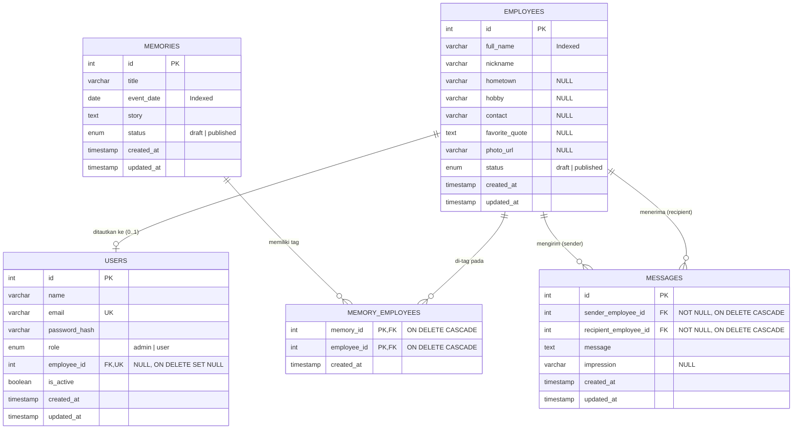

# Database Design — Warga Halim

Dokumen desain database ini disusun berdasarkan [PRD.md](file:///c:/Users/dimas/Desktop/Belajar/github/4-kampung-halim/docs/PRD.md) (Bagian 8 dan Bagian 9).

---

## 1. Spesifikasi Umum

- **DBMS:** MySQL (eksternal, mis. Railway / Aiven / TiDB Cloud untuk deployment Vercel).
- **Library Akses:** `mysql2` (`mysql2/promise`) dengan *connection pool* dan wajib menggunakan *parameterized query* (`?`) untuk seluruh query.
- **Konfigurasi Pool Serverless:** Karena Express dijalankan sebagai Vercel Serverless Function, ukuran `connectionLimit` pada pool dijaga kecil (mis. `5`) agar tidak melebihi batas koneksi database eksternal.
- **Charset & Collation:** `utf8mb4` / `utf8mb4_unicode_ci` pada seluruh tabel.
- **Konvensi Timestamp:**
  - `users`, `employees`, dan `memories` memiliki `created_at` dan `updated_at`.
  - `memory_employees` hanya memiliki `created_at` (tanpa `updated_at`, sesuai PRD).
  - `messages` memiliki `created_at` dan `updated_at` pada skema DDL `schema.sql`, namun secara aturan bisnis tidak ada operasi edit pesan (`PUT`/`PATCH`).
- **Penyimpanan Foto:** Foto tidak disimpan di database. Kolom `employees.photo_url` hanya menyimpan URL publik dari **Vercel Blob**.

---

## 2. Entity Relationship Diagram (ERD)

---

## 3. Spesifikasi 5 Tabel

### 3.1 `users`

Menyimpan akun login untuk admin (1 baris dari seed) dan user (mantan karyawan yang dibuat dan dikelola oleh admin).

| Kolom | Tipe Data | Constraint | Keterangan |
| --- | --- | --- | --- |
| `id` | `INT UNSIGNED` | `PRIMARY KEY AUTO_INCREMENT` | ID unik akun |
| `name` | `VARCHAR(150)` | `NOT NULL` | Nama user (ditampilkan di header saat login) |
| `email` | `VARCHAR(255)` | `NOT NULL UNIQUE` | Email login, wajib unik |
| `password_hash` | `VARCHAR(255)` | `NOT NULL` | Hash bcrypt dari password (jangan simpan plaintext) |
| `role` | `ENUM('admin', 'user')` | `NOT NULL DEFAULT 'user'` | Peran akun (`admin` hanya dari seed) |
| `employee_id` | `INT UNSIGNED` | `NULL UNIQUE` | Tautan opsional ke `employees.id` (`ON DELETE SET NULL`) |
| `is_active` | `TINYINT(1)` | `NOT NULL DEFAULT 1` | Status aktif akun (`1` aktif, `0` dinonaktifkan admin) |
| `created_at` | `TIMESTAMP` | `NOT NULL DEFAULT CURRENT_TIMESTAMP` | Waktu pembuatan akun |
| `updated_at` | `TIMESTAMP` | `NOT NULL DEFAULT CURRENT_TIMESTAMP ON UPDATE CURRENT_TIMESTAMP` | Waktu pembaruan terakhir |

**Foreign Key:**
- `CONSTRAINT fk_users_employee FOREIGN KEY (employee_id) REFERENCES employees(id) ON DELETE SET NULL ON UPDATE CASCADE`

---

### 3.2 `employees`

Menyimpan data dan biodata lengkap mantan karyawan.

| Kolom | Tipe Data | Constraint | Keterangan |
| --- | --- | --- | --- |
| `id` | `INT UNSIGNED` | `PRIMARY KEY AUTO_INCREMENT` | ID unik karyawan |
| `full_name` | `VARCHAR(150)` | `NOT NULL` | Nama lengkap karyawan |
| `nickname` | `VARCHAR(100)` | `NOT NULL` | Nama panggilan |
| `hometown` | `VARCHAR(150)` | `NULL` | Kota asal (opsional) |
| `hobby` | `VARCHAR(255)` | `NULL` | Hobi (opsional) |
| `contact` | `VARCHAR(255)` | `NULL` | Kontak (opsional) |
| `favorite_quote` | `TEXT` | `NULL` | Kutipan favorit (opsional) |
| `photo_url` | `VARCHAR(500)` | `NULL` | URL foto di Vercel Blob (opsional) |
| `status` | `ENUM('draft', 'published')` | `NOT NULL DEFAULT 'draft'` | Status publikasi |
| `created_at` | `TIMESTAMP` | `NOT NULL DEFAULT CURRENT_TIMESTAMP` | Waktu pembuatan |
| `updated_at` | `TIMESTAMP` | `NOT NULL DEFAULT CURRENT_TIMESTAMP ON UPDATE CURRENT_TIMESTAMP` | Waktu pembaruan terakhir |

**Index:**
- `PRIMARY KEY (id)`
- `INDEX idx_employees_full_name (full_name)` — mendukung pencarian nama (`?search=`).
- `INDEX idx_employees_status (status)` — mendukung penyaringan status `published` untuk sisi user & `/photos`.

---

### 3.3 `memories`

Menyimpan cerita kenangan bersama yang bertanggal.

| Kolom | Tipe Data | Constraint | Keterangan |
| --- | --- | --- | --- |
| `id` | `INT UNSIGNED` | `PRIMARY KEY AUTO_INCREMENT` | ID unik kenangan |
| `title` | `VARCHAR(200)` | `NOT NULL` | Judul kenangan |
| `event_date` | `DATE` | `NOT NULL` | Tanggal kejadian |
| `story` | `TEXT` | `NOT NULL` | Cerita lengkap kenangan |
| `status` | `ENUM('draft', 'published')` | `NOT NULL DEFAULT 'draft'` | Status publikasi |
| `created_at` | `TIMESTAMP` | `NOT NULL DEFAULT CURRENT_TIMESTAMP` | Waktu pembuatan |
| `updated_at` | `TIMESTAMP` | `NOT NULL DEFAULT CURRENT_TIMESTAMP ON UPDATE CURRENT_TIMESTAMP` | Waktu pembaruan terakhir |

**Index:**
- `PRIMARY KEY (id)`
- `INDEX idx_memories_event_date (event_date)` — mendukung pengurutan terbaru di atas (`ORDER BY event_date DESC`).
- `INDEX idx_memories_status_event_date (status, event_date)` — mempercepat query daftar kenangan terbit.

---

### 3.4 `memory_employees`

Tabel pivot *many-to-many* antara `memories` dan `employees` untuk tag karyawan yang terlibat dalam kenangan. Sesuai PRD, tabel ini **tidak memiliki** kolom `updated_at`.

| Kolom | Tipe Data | Constraint | Keterangan |
| --- | --- | --- | --- |
| `memory_id` | `INT UNSIGNED` | `NOT NULL` | Referensi ke `memories.id` |
| `employee_id` | `INT UNSIGNED` | `NOT NULL` | Referensi ke `employees.id` |
| `created_at` | `TIMESTAMP` | `NOT NULL DEFAULT CURRENT_TIMESTAMP` | Waktu tag dibuat |

**Primary Key & Foreign Key:**
- `PRIMARY KEY (memory_id, employee_id)`
- `CONSTRAINT fk_me_memory FOREIGN KEY (memory_id) REFERENCES memories(id) ON DELETE CASCADE ON UPDATE CASCADE`
- `CONSTRAINT fk_me_employee FOREIGN KEY (employee_id) REFERENCES employees(id) ON DELETE CASCADE ON UPDATE CASCADE`

---

### 3.5 `messages`

Menyimpan pesan dan kesan antar karyawan (pengirim -> penerima). Sesuai PRD, pesan hanya ditambah dan dihapus oleh admin tanpa fitur edit pesan (`PUT`/`PATCH`) maupun kolom `status` (pesan yang dibuat admin langsung aktif/terbit).

| Kolom | Tipe Data | Constraint | Keterangan |
| --- | --- | --- | --- |
| `id` | `INT UNSIGNED` | `PRIMARY KEY AUTO_INCREMENT` | ID unik pesan |
| `sender_employee_id` | `INT UNSIGNED` | `NOT NULL` | ID karyawan pengirim (`employees.id`) |
| `recipient_employee_id` | `INT UNSIGNED` | `NOT NULL` | ID karyawan penerima (`employees.id`) |
| `message` | `TEXT` | `NOT NULL` | Isi pesan |
| `impression` | `VARCHAR(300)` | `NULL` | Kesan singkat satu kalimat (opsional) |
| `created_at` | `TIMESTAMP` | `NOT NULL DEFAULT CURRENT_TIMESTAMP` | Waktu pesan dibuat |
| `updated_at` | `TIMESTAMP` | `NOT NULL DEFAULT CURRENT_TIMESTAMP ON UPDATE CURRENT_TIMESTAMP` | Waktu pembaruan pesan terakhir |

**Foreign Key, Check, & Index:**
- `CONSTRAINT fk_messages_sender FOREIGN KEY (sender_employee_id) REFERENCES employees(id) ON DELETE CASCADE ON UPDATE CASCADE`
- `CONSTRAINT fk_messages_recipient FOREIGN KEY (recipient_employee_id) REFERENCES employees(id) ON DELETE CASCADE ON UPDATE CASCADE`
- `CONSTRAINT chk_messages_different_employees CHECK (sender_employee_id <> recipient_employee_id)` — memastikan pengirim dan penerima adalah karyawan yang berbeda. *(Catatan: pada server juga tetap divalidasi oleh Zod/controller agar kompatibel dengan semua versi MySQL/TiDB).*
- `INDEX idx_messages_sender (sender_employee_id)`
- `INDEX idx_messages_recipient (recipient_employee_id)`

---

## 4. Aturan Relasi & Integritas Data

1. **Penghapusan `employees`:**
   - Menghapus karyawan otomatis menghapus seluruh pesan di mana ia menjadi pengirim (`sender_employee_id`) maupun penerima (`recipient_employee_id`) melalui `ON DELETE CASCADE`.
   - Menghapus karyawan otomatis menghapus tag keterlibatannya di `memory_employees` (`ON DELETE CASCADE`), tetapi baris cerita kenangan di `memories` tetap ada.
   - Akun `users` yang tertaut (`users.employee_id`) tetap ada, dengan `employee_id` dikosongkan menjadi `NULL` melalui `ON DELETE SET NULL`.
2. **Penghapusan `memories`:**
   - Menghapus kenangan otomatis menghapus relasinya di `memory_employees` (`ON DELETE CASCADE`), tanpa memengaruhi data `employees`.
3. **Visibilitas Konten:**
   - Role `user` hanya dapat melihat `employees` dan `memories` dengan `status = 'published'`.
   - Tag pada `memory_employees` yang ditampilkan ke `user` hanya menyertakan karyawan dengan `employees.status = 'published'`.
   - Pesan pada `messages` yang ditampilkan ke `user` hanya pesan di mana **kedua** karyawan (`sender` dan `recipient`) berstatus `published`, agar biodata/nama karyawan `draft` tidak bocor.
   - Endpoint publik `GET /api/photos` hanya membaca kolom `id` dan `photo_url` dari `employees` dengan `status = 'published' AND photo_url IS NOT NULL`.
4. **Satu Karyawan Banyak Pesan:**
   - Tidak ada *unique constraint* pada `(sender_employee_id, recipient_employee_id)` sehingga satu karyawan dapat mengirim banyak pesan ke berbagai karyawan lain (termasuk lebih dari satu pesan ke penerima yang sama).
5. **Aturan Pengelolaan Pesan & Penautan Akun User:**
   - Pesan antar karyawan hanya dapat ditambahkan dan dihapus oleh Admin (`POST` & `DELETE /api/admin/messages`), tanpa fitur edit pesan (`PUT`/`PATCH`). Pengirim dan penerima wajib merupakan karyawan valid dan berbeda (`sender_employee_id <> recipient_employee_id`).
   - Penautan akun `users` ke `employees` (`users.employee_id`) hanya dilakukan oleh Admin melalui `PUT /api/admin/users/:id`. Karena kolom `employee_id` bersifat `UNIQUE`, satu karyawan hanya dapat terhubung ke maksimal satu akun user (`409 Conflict` jika sudah terhubung ke user lain).

---

## 5. File SQL & Skrip Pemeliharaan (`server/src/db/`)

1. **`schema.sql`:** DDL pembuatan 5 tabel beserta charset `utf8mb4`, foreign keys, check constraint, dan index.
2. **`seed.sql`:** Data contoh untuk pengembangan & demo:
   - 1 akun `admin` (`role = 'admin'`, `password_hash` hasil bcrypt — wajib diganti saat produksi).
   - Contoh akun `user` (`role = 'user'`).
   - Contoh data `employees`, `memories`, `memory_employees`, dan `messages` (pengirim -> penerima).
3. **Skrip Reset Password Admin:** Skrip CLI Node/TypeScript untuk menulis ulang `password_hash` akun admin di tabel `users` (penanganan risiko admin lupa password di PRD Bagian 10).

