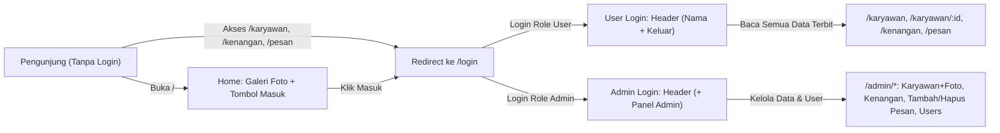
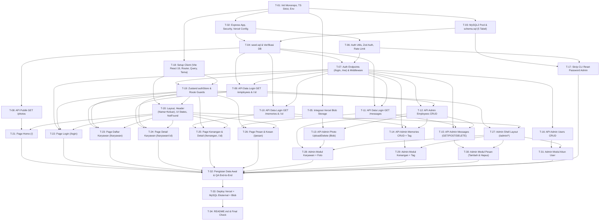

# Development Plan — Warga Halim

Dokumen analisis dan rencana pengembangan ini disusun berdasarkan [PRD.md](file:///c:/Users/dimas/Desktop/Belajar/github/4-kampung-halim/docs/PRD.md), serta diselaraskan dengan [DATABASE_DESIGN.md](file:///c:/Users/dimas/Desktop/Belajar/github/4-kampung-halim/docs/DATABASE_DESIGN.md), [API_DOCUMENTATION.md](file:///c:/Users/dimas/Desktop/Belajar/github/4-kampung-halim/docs/API_DOCUMENTATION.md), dan [TEST_PLAN.md](file:///c:/Users/dimas/Desktop/Belajar/github/4-kampung-halim/docs/TEST_PLAN.md).

---

## Bagian A — Analisis PRD (Task 1)

### 1. Identifikasi Seluruh Fitur Berdasarkan PRD
| Kode | Fitur | Akses | Ringkasan Lingkup MVP |
| --- | --- | --- | --- |
| **F1** | Halaman Beranda / Home (`/`) | Publik | Menampilkan galeri foto-foto karyawan (tanpa biodata) untuk pengunjung belum login + tombol Masuk (`/login`); bagi user login menjadi gerbang menu navigasi ke Karyawan, Kenangan, dan Pesan & Kesan. |
| **F2** | Karyawan dan Biodata (`/karyawan`, `/karyawan/:id`) | User & Admin | Daftar kartu karyawan (foto atau avatar inisial, nama panggilan dan nama lengkap) + live search nama; halaman detail berisi foto/avatar, biodata lengkap, kenangan terkait, serta pesan yang diterima/dikirim. |
| **F3** | Kenangan (`/kenangan`, `/kenangan/:id`) | User & Admin | Daftar kenangan bertanggal terbaru di atas (judul, tanggal, potongan cerita) dan detail cerita lengkap beserta daftar karyawan yang di-tag (klik nama mengarah ke `/karyawan/:id`). |
| **F4** | Pesan dan Kesan (`/pesan`) | User (tulis & edit pesan sendiri) & Admin (hapus/kelola) | Menampilkan seluruh pesan antar karyawan (1 karyawan dapat memiliki banyak pesan). User tertaut dapat menulis pesan & mengedit pesannya sendiri (server mengunci pengirim dari token login). User belum tertaut ditolak menulis pesan; user dilarang mengubah pesan orang lain. Admin dapat menghapus pesan. |
| **F5** | Login & Sesi User (`/login`) | Publik & Terproteksi | Login email & password untuk user & admin (tanpa halaman `/daftar` & tanpa halaman `/akun`). Token JWT disimpan di Zustand (`localStorage`). Header menampilkan nama user + tombol Keluar (plus Panel Admin untuk admin). |
| **F6** | Panel Admin (`/admin/*`) | Admin | CRUD Karyawan (+ unggah/ganti/hapus foto JPG/PNG/WebP maks 2 MB ke Vercel Blob), CRUD Kenangan (+ tag karyawan), Kelola/Hapus Pesan, dan CRUD Akun User (termasuk aktif/nonaktifkan). |

**Di luar scope (tidak dikerjakan):** registrasi mandiri, halaman `/akun`, edit pesan milik orang lain, tabel `company_profile`, upload foto oleh user, upload video, login OAuth/sosial media, lupa/ganti password oleh user, filter divisi/angkatan, dark mode, export PDF, dan dashboard statistik admin.

---

### 2. Identifikasi Role dan Permission
| Peran | Autentikasi | Boleh Melihat | Boleh Mengubah / Mengelola | Ditolak |
| --- | --- | --- | --- | --- |
| **Pengunjung** | Tanpa login | Home (`/`, hanya galeri foto-foto via `GET /api/photos`), Login (`/login`), Not Found (`*`) | Tidak ada | Daftar karyawan, biodata karyawan (diri maupun orang lain), kenangan, pesan & kesan, dan Panel Admin (otomatis diarahkan ke `/login`). |
| **User** | Login JWT (`role = 'user'`, `is_active = 1`) | Semua halaman & data berstatus `published`: Home, `/karyawan`, `/karyawan/:id`, `/kenangan`, `/kenangan/:id`, `/pesan` | Menulis dan mengedit pesan miliknya sendiri (khusus jika akun tertaut ke profil karyawan) | Panel Admin (`/admin/*`), data berstatus `draft`, mengubah pesan orang lain, dan menulis pesan jika akun belum ditautkan (`employee_id` null). |
| **Admin** | Login JWT (`role = 'admin'`, `is_active = 1`) | Semua data (termasuk `draft` & `published`) serta seluruh modul Panel Admin | Mengelola karyawan, foto karyawan, kenangan + tag, akun user (tambah/ubah/nonaktif/hapus), serta tambah & hapus pesan | Dicegah menonaktifkan atau menghapus akun admin miliknya sendiri. |

---

### 3. Identifikasi Alur Pengunjung, User, dan Admin

- **Alur Pengunjung:** Buka link -> lihat galeri foto di `/` dan tombol Masuk -> jika membuka route data (`/karyawan`, `/kenangan`, `/pesan`, dll.) langsung diarahkan ke `/login` -> jika URL salah tampil halaman `*` dengan tombol kembali ke Home.
- **Alur User:** Akun dibuatkan admin -> login di `/login` -> token disimpan di Zustand (`authStore`) -> header menampilkan menu lengkap, nama user, dan tombol Keluar -> membaca seluruh daftar/detail karyawan, kenangan, dan pesan terbit (tanpa aksi ubah/hapus) -> bila token kedaluwarsa (`401`), otomatis diarahkan ke `/login`.
- **Alur Admin:** Login di `/login` -> masuk `/admin/*` -> kelola Akun User, Karyawan (+ upload/ganti/hapus foto ke Vercel Blob), Kenangan (+ tag), dan Pesan & Kesan (hanya tambah pengirim->penerima dan hapus, tanpa edit) -> validasi error bahasa Indonesia per kolom + tombol nonaktif saat loading + konfirmasi hapus + toast hijau/merah -> perubahan berstatus `Terbit` langsung terlihat oleh user login.

---

### 4. Identifikasi Kebutuhan Database dan Relasinya
Database menggunakan MySQL (`utf8mb4`) dengan library `mysql2` (connection pool kecil + parameterized query `?`), terdiri dari **5 tabel**:
1. **`users`** (`id`, `name`, `email` UNIQUE, `password_hash`, `role` `admin|user`, `is_active`, `created_at`, `updated_at`)
2. **`employees`** (`id`, `full_name` INDEXED, `nickname`, `hometown` NULL, `hobby` NULL, `contact` NULL, `favorite_quote` NULL, `photo_url` NULL, `status` `draft|published`, `created_at`, `updated_at`)
3. **`memories`** (`id`, `title`, `event_date` INDEXED, `story`, `status` `draft|published`, `created_at`, `updated_at`)
4. **`memory_employees`** (`memory_id`, `employee_id` PK gabungan, `created_at` tanpa `updated_at`, `ON DELETE CASCADE` ke `memories` dan `employees`)
5. **`messages`** (`id`, `sender_employee_id`, `recipient_employee_id`, `message`, `impression` NULL, `created_at`, `updated_at`, `ON DELETE CASCADE` ke `employees`, `CHECK sender_employee_id <> recipient_employee_id`)

*(Detail skema dan ERD lengkap ada di [DATABASE_DESIGN.md](file:///c:/Users/dimas/Desktop/Belajar/github/4-kampung-halim/docs/DATABASE_DESIGN.md).)*

---

### 5. Identifikasi Seluruh API Endpoint
- **Publik:** `GET /api/photos` (hanya URL foto karyawan `published` tanpa biodata), `POST /api/auth/login`.
- **User atau Admin (wajib JWT & `is_active = 1`):** `GET /api/auth/me`, `GET /api/employees?search=`, `GET /api/employees/:id`, `GET /api/memories`, `GET /api/memories/:id`, `GET /api/messages`, `POST /api/messages` (tulis pesan), `PUT /api/messages/:id` (ubah pesan sendiri), `DELETE /api/messages/:id` (hapus pesan sendiri).
- **Admin (`role === 'admin'`):**
  - `GET, POST, PUT, DELETE /api/admin/employees` (+ `/:id`)
  - `POST, DELETE /api/admin/employees/:id/photo`
  - `GET, POST, PUT, DELETE /api/admin/memories` (+ `/:id`)
  - `GET, POST, DELETE /api/admin/messages` (+ `/:id`)
  - `GET, POST, PUT, DELETE /api/admin/users` (+ `/:id`)

*(Detail kontrak request/response ada di [API_DOCUMENTATION.md](file:///c:/Users/dimas/Desktop/Belajar/github/4-kampung-halim/docs/API_DOCUMENTATION.md).)*

---

### 6. Identifikasi Kebutuhan Keamanan
- **Autentikasi & Otorisasi:** Password di-hash `bcryptjs`; token JWT berumur `1d`; middleware memeriksa token, `role`, dan `is_active` pada setiap endpoint terproteksi; admin dicegah menghapus/menonaktifkan dirinya sendiri.
- **Proteksi Data Publik:** Pengunjung tanpa token hanya mengakses `POST /api/auth/login` dan `GET /api/photos` (tanpa membocorkan nama ataupun biodata); endpoint data hanya mengembalikan konten `published` untuk `user`.
- **Anti-Brute Force & HTTP Security:** `express-rate-limit` (5 percobaan/menit di `POST /api/auth/login`), `cors` dibatasi ke `CLIENT_URL`, dan `helmet`.
- **Validasi & Anti-Injection:** Validasi dua lapis (React Hook Form + Zod di client, Zod di server), seluruh SQL query memakai placeholder `?` (`mysql2`), serta validasi tipe (JPG/PNG/WebP) dan ukuran (<= 2 MB) unggahan foto di client dan server.
- **Manajemen Kredensial & TypeScript:** `.env` dikecualikan dari Git (sediakan `.env.example`), password seed admin wajib diganti sebelum produksi (plus skrip CLI reset password admin), dan TypeScript `strict: true` tanpa tipe `any`.

---

### 7. Hasil Pemeriksaan Requirement yang Bertentangan atau Belum Jelas
Setelah meninjau [PRD.md](file:///c:/Users/dimas/Desktop/Belajar/github/4-kampung-halim/docs/PRD.md) final bersama daftar stack proyek:
- **Tidak ditemukan pertentangan aturan inti** di dalam `PRD.md` maupun antara `PRD.md` dan ketentuan stack (`Vite + React 19 + TypeScript`, `Zustand` untuk auth state tanpa `React Context` & tanpa `useReducer`, `TanStack Query` untuk server state, `Express + TypeScript + MySQL2 + Zod`).
- Terdapat **4 detail implementasi minor** yang perlu disepakati teknisinya (sudah disiapkan rekomendasi aman tanpa menambah fitur di luar PRD):

| Kode | Poin yang Perlu Kejelasan | Rekomendasi Penyelesaian |
| --- | --- | --- |
| **C-01** | `GET /api/photos` pada Home pengunjung (`/`): ketika ada karyawan yang belum punya foto (`photo_url IS NULL`), apakah placeholder inisial ditampilkan ke pengunjung atau disembunyikan? | Hanya mengembalikan `{ id, photo_url }` untuk karyawan `published` yang sudah memiliki `photo_url` (dengan teks `alt` generik seperti `"Foto kenangan Warga Halim"`), agar inisial/nama karyawan tidak bocor ke pengunjung belum login. |
| **C-02** | Tampilan Home (`/`) bagi user yang **sudah login**: `F1` menyebut *"Setelah login, user dapat melihat seluruh menu navigasi..."*, sementara `Daftar halaman` menyebut *"ringkasan & navigasi menu bagi user login"*. | Untuk pengunjung tampil galeri foto + tombol Masuk; untuk user login tampil sambutan ringkas + kartu akses cepat ke `/karyawan`, `/kenangan`, `/pesan` + galeri foto. |
| **C-03** | Tampilan pesan di `/pesan` & `/karyawan/:id` dengan model `sender_employee_id -> recipient_employee_id`. | Di `/pesan`, tampilkan kartu dengan label jelas **"Dari [Pengirim] untuk [Penerima]"**. Di `/karyawan/:id`, tampilkan pesan yang melibatkan karyawan tersebut (pesan diterima & pesan dikirim) dengan label arah pengirim -> penerima yang sama. |
| **C-04** | Catatan teknis Vercel Serverless pada `express-rate-limit`: penyimpanan in-memory bawaan bersifat per-instance serverless. | Untuk MVP tetap gunakan `express-rate-limit` bawaan sesuai PRD (tanpa menambah dependency database/Redis baru di luar PRD). |

---

## Bagian B — Ketentuan Arsitektur & Batasan Teknis (Task 2)

- **Frontend (`client/`):** Vite + React 19 + TypeScript (`strict`, tanpa `any`), React Router, TanStack Query, **Zustand (`stores/authStore.ts`)**, React Hook Form + Zod (`zodResolver`), `react-hot-toast`. **Dilarang menggunakan `useReducer` maupun `React Context` untuk state.**
- **Backend (`server/`):** Express + TypeScript (`strict`, tanpa `any`), `mysql2` pool, Zod, `dotenv`, `bcryptjs`, `jsonwebtoken`, `cors`, `helmet`, `express-rate-limit`, `multer` (memory storage), `@vercel/blob`.
- **Desain UI/UX:** Bahasa Indonesia, palet **biru langit + putih** dengan aksen **merah scarlet**, judul **serif**, isi **sans-serif >= 16px**, grid 1/2/3 kolom responsif mulai `360px`, serta wajib memiliki *loading skeleton*, *empty state*, dan *error state + tombol coba lagi* di setiap halaman data.

---

## Bagian C — Diagram Dependency Antar-Task

---

## Bagian D — Rincian Task Kecil & Acceptance Criteria

### Tahap 1 — Persiapan Repo, Database, & Storage

#### `T-01` — Inisialisasi Struktur Monorepo `warga-halim`, TypeScript Strict, & `.env.example`
- **Deskripsi:** Menyiapkan folder `client/` (Vite + React 19 + TypeScript) dan `server/` (Express + TypeScript) sesuai struktur folder PRD Bagian 9 (`stores/` untuk Zustand), mengaktifkan `"strict": true` (tanpa `any`), membuat `.gitignore`, serta menyiapkan `.env.example` client & server.
- **Dependency:** Tidak ada.
- **Acceptance Criteria:**
  - Struktur folder `client/src/{pages,components,features,stores,lib}` dan `server/src/{routes,controllers,schemas,middleware,db}` terbentuk.
  - `tsconfig.json` pada `client` dan `server` mengaktifkan `"strict": true` dan `"noImplicitAny": true`.
  - `server/.env.example` memuat `DB_HOST`, `DB_PORT`, `DB_USER`, `DB_PASSWORD`, `DB_NAME`, `JWT_SECRET`, `CLIENT_URL`, `BLOB_READ_WRITE_TOKEN`; `client/.env.example` memuat `VITE_API_URL`.
  - `.env` tidak pernah terlacak Git.

#### `T-02` — Setup Express App, Security Middleware, & Vercel Config
- **Deskripsi:** Membuat `server/src/app.ts` (ekspor app untuk Vercel serverless), `server/src/server.ts` (listener lokal), `server/vercel.json`, middleware `helmet`, `cors` (origin `CLIENT_URL`), helper respons `{ success, data, message }`, dan global error handler bahasa Indonesia.
- **Dependency:** `T-01`
- **Acceptance Criteria:**
  - `app.ts` mengekspor instance Express tanpa memanggil `app.listen()`.
  - `vercel.json` mengarahkan `/api/*` ke serverless function Express.
  - Request route yang tidak ditemukan mengembalikan `404` dalam format `{ success: false, data: null, message: "..." }`.

#### `T-03` — Koneksi Pool `mysql2` & `schema.sql` (5 Tabel)
- **Deskripsi:** Membuat modul koneksi pool `mysql2/promise` (ukuran pool kecil untuk serverless) dan `server/src/db/schema.sql` berisi 5 tabel (`users`, `employees`, `memories`, `memory_employees`, `messages`) sesuai [DATABASE_DESIGN.md](file:///c:/Users/dimas/Desktop/Belajar/github/4-kampung-halim/docs/DATABASE_DESIGN.md).
- **Dependency:** `T-01`
- **Acceptance Criteria:**
  - `schema.sql` berjalan tanpa error di MySQL dan menghasilkan 5 tabel `utf8mb4`.
  - `memory_employees` tidak memiliki `updated_at`; `messages` tidak memiliki `updated_at` maupun `status` dan memiliki `sender_employee_id`, `recipient_employee_id`, serta constraint pengirim <> penerima.
  - Index `employees.full_name` dan `memories.event_date` serta `ON DELETE CASCADE` terpasang.

#### `T-04` — Pembuatan `seed.sql` & Verifikasi Pembacaan DB
- **Deskripsi:** Menyusun `server/src/db/seed.sql` berisi 1 akun admin (bcrypt), contoh akun user, data karyawan, kenangan, `memory_employees`, dan pesan antar karyawan, lalu memverifikasi server dapat menyala dan membaca satu tabel.
- **Dependency:** `T-02`, `T-03`
- **Acceptance Criteria:**
  - `seed.sql` dapat dijalankan di skema bersih tanpa error.
  - Password pada baris `users` menggunakan hash bcrypt (bukan plaintext).
  - Server menyala dan query baca ke tabel MySQL berhasil.

#### `T-05` — Integrasi Vercel Blob untuk Upload & Hapus Foto
- **Deskripsi:** Membuat helper storage di server menggunakan `@vercel/blob` (`put` dan `del`) dengan `BLOB_READ_WRITE_TOKEN`.
- **Dependency:** `T-01`
- **Acceptance Criteria:**
  - Helper dapat mengunggah buffer gambar ke Vercel Blob dan mengembalikan URL publik.
  - Helper dapat menghapus file di Vercel Blob berdasarkan URL.

---

### Tahap 2 — Login & Keamanan Backend

#### `T-06` — Utilitas `bcryptjs`, JWT, Zod Auth Schema, & Rate Limiter
- **Deskripsi:** Mengimplementasikan hash/verify `bcryptjs`, sign/verify JWT (`1d`), schema Zod untuk login, serta `express-rate-limit` (maksimal 5 percobaan/menit pada `/api/auth/login`).
- **Dependency:** `T-02`
- **Acceptance Criteria:**
  - JWT memiliki expiry `1d` dan hanya ditandatangani dengan `JWT_SECRET`.
  - Percobaan login ke-6 dalam 1 menit ditolak dengan HTTP `429` dan pesan bahasa Indonesia.

#### `T-07` — Endpoint `POST /api/auth/login`, `GET /api/auth/me`, & Middleware Pelindung
- **Deskripsi:** Mengimplementasikan login, cek sesi `/auth/me`, middleware `authenticate` (verifikasi JWT + cek `is_active` dari DB), dan middleware `authorizeAdmin`.
- **Dependency:** `T-04`, `T-06`
- **Acceptance Criteria:**
  - Login berhasil mengembalikan JWT dan data user (tanpa `password_hash`); akun `is_active = 0` ditolak (`403`); password salah ditolak (`401`).
  - Endpoint tanpa token atau token kedaluwarsa ditolak `401`.
  - `authorizeAdmin` menolak token ber-role `user` dengan `403`.
  - Tidak ada endpoint `/api/auth/register`.

---

### Tahap 3 — API Foto Publik & API Data (Khusus Login)

#### `T-08` — Endpoint Publik `GET /api/photos`
- **Deskripsi:** Mengembalikan daftar `{ id, photo_url }` hanya untuk karyawan `published` yang memiliki `photo_url`.
- **Dependency:** `T-04`
- **Acceptance Criteria:**
  - Dapat diakses tanpa token (`200 OK`).
  - Tidak pernah mengembalikan `full_name`, `nickname`, atau kolom biodata lainnya, dan tidak mengikutsertakan karyawan berstatus `draft`.

#### `T-09` — Endpoint Login `GET /api/employees` & `GET /api/employees/:id`
- **Deskripsi:** Membuat endpoint daftar karyawan terbit (mendukung `?search=` dengan parameterized query `?`) dan detail biodata karyawan (foto, biodata lengkap, kenangan terkait, dan pesan terkait), keduanya terproteksi `authenticate`.
- **Dependency:** `T-04`, `T-07`
- **Acceptance Criteria:**
  - Request tanpa token selalu ditolak `401`.
  - `?search=` memfilter nama karyawan `published` secara aman (kebal SQL injection).
  - `GET /api/employees/:id` mengembalikan biodata lengkap (aman saat kolom opsional `NULL`), kenangan terbit terkait, dan pesan terkait (hanya jika pengirim & penerima berstatus `published`). Karyawan `draft` mengembalikan `404` untuk role `user`.

#### `T-10` — Endpoint Login `GET /api/memories` & `GET /api/memories/:id`
- **Deskripsi:** Membuat endpoint daftar kenangan terbit (`event_date DESC`) dan detail kenangan beserta daftar karyawan terbit yang di-tag, terproteksi `authenticate`.
- **Dependency:** `T-04`, `T-07`
- **Acceptance Criteria:**
  - Tanpa token ditolak `401`.
  - Daftar terurut dari kejadian terbaru; detail mengembalikan cerita lengkap + karyawan `published` yang di-tag; kenangan `draft` mengembalikan `404` untuk role `user`.

#### `T-11` — Endpoint Pesan dan Kesan (`GET, POST, PUT, DELETE /api/messages`)
- **Deskripsi:** Membuat endpoint membaca seluruh pesan terbit (`GET`), menulis pesan baru (`POST`), mengubah pesan milik sendiri (`PUT /:id`), dan menghapus pesan sendiri atau oleh admin (`DELETE /:id`), terproteksi `authenticate`.
- **Dependency:** `T-04`, `T-07`
- **Acceptance Criteria:**
  - Tanpa token ditolak `401`.
  - `GET` mengembalikan seluruh pesan terbit (pengirim & penerima `published`).
  - `POST`: user belum ditautkan (`req.user.employee_id === null`) ditolak `403`.
  - `POST`: server mengunci `sender_employee_id` dari `req.user.employee_id` (anti-impersonasi, abaikan input body).
  - `POST`: kirim pesan ke diri sendiri (`recipient_employee_id === req.user.employee_id`) ditolak `400`.
  - `PUT /:id`: user mengubah pesan milik orang lain ditolak server `403`.
  - `DELETE /:id`: hanya pemilik pesan atau admin yang boleh menghapus (`403` bila user lain).

---

### Tahap 4 — API Panel Admin & Skrip Reset Password

#### `T-12` — API Admin CRUD Karyawan (`/api/admin/employees`)
- **Deskripsi:** Implementasi `GET`, `GET /:id`, `POST`, `PUT`, `DELETE` karyawan khusus `admin` dengan validasi Zod.
- **Dependency:** `T-07`, `T-09`
- **Acceptance Criteria:**
  - User biasa ditolak `403`.
  - `GET` memuat karyawan `draft` dan `published`; `POST`/`PUT` menormalisasi kolom opsional kosong ke `NULL`; input salah ditolak `400` dengan pesan bahasa Indonesia.
  - `DELETE` menghapus karyawan beserta fotonya di Vercel Blob (bila ada).

#### `T-13` — API Admin Unggah & Hapus Foto Karyawan (`/api/admin/employees/:id/photo`)
- **Deskripsi:** Implementasi `POST` & `DELETE` foto karyawan menggunakan `multer` memory storage dan helper Vercel Blob (`T-05`).
- **Dependency:** `T-05`, `T-12`
- **Acceptance Criteria:**
  - Hanya menerima `image/jpeg`, `image/png`, `image/webp` dengan ukuran maksimal `2 MB`; selain itu ditolak `400` dengan pesan jelas.
  - Mengunggah foto baru menghapus foto lama di Vercel Blob (jika ada) dan menyimpan URL baru ke `employees.photo_url`.
  - `DELETE` menghapus blob dan mengosongkan `photo_url`.

#### `T-14` — API Admin CRUD Kenangan (`/api/admin/memories`)
- **Deskripsi:** Implementasi `GET`, `GET /:id`, `POST`, `PUT`, `DELETE` kenangan beserta sinkronisasi `memory_employees` dalam transaksi SQL.
- **Dependency:** `T-07`, `T-10`, `T-12`
- **Acceptance Criteria:**
  - Memuat `draft` dan `published`; tag karyawan tersimpan atomik dalam transaksi.
  - Input tidak valid ditolak `400`.

#### `T-15` — API Admin Tambah & Hapus Pesan (`/api/admin/messages`)
- **Deskripsi:** Implementasi `GET`, `POST`, `DELETE` pesan khusus `admin` dengan validasi Zod (`sender_employee_id !== recipient_employee_id`). **Tidak membuat endpoint `PUT`.**
- **Dependency:** `T-07`, `T-11`, `T-12`
- **Acceptance Criteria:**
  - 1 karyawan dapat dibuatkan banyak pesan untuk karyawan lainnya.
  - Pengirim dan penerima yang sama ditolak `400`.
  - Tidak ada route `PUT /api/admin/messages/:id`.

#### `T-16` — API Admin Kelola Akun User (`/api/admin/users`)
- **Deskripsi:** Implementasi `GET`, `POST`, `PUT`, `DELETE` akun user khusus `admin` dengan hash `bcryptjs` dan validasi email unik (`409`).
- **Dependency:** `T-07`
- **Acceptance Criteria:**
  - `GET` tidak pernah mengembalikan `password_hash`.
  - `POST` membuat user (`role = 'user'`) dengan password ter-hash; email duplikat ditolak `409`.
  - `PUT` dapat mengubah data & status `is_active`; admin dicegah menonaktifkan/menghapus akun dirinya sendiri (`400`).

#### `T-17` — Skrip CLI Reset Password Admin
- **Deskripsi:** Skrip lokal di `server/src/db/` untuk memperbarui `password_hash` akun admin secara aman menggunakan `bcryptjs`.
- **Dependency:** `T-03`, `T-06`
- **Acceptance Criteria:**
  - Menjalankan skrip memperbarui `password_hash` akun admin di database sehingga admin dapat login dengan password baru.

---

### Tahap 5 — Fondasi Frontend, Zustand, & Halaman Publik/User

#### `T-18` — Setup Fondasi Client (`Vite + React 19`, Router, TanStack Query, API Client, Tema)
- **Deskripsi:** Konfigurasi `React Router`, `QueryClientProvider` (TanStack Query), `<Toaster />` (`react-hot-toast`), HTTP client (`VITE_API_URL`, auto-attach Bearer token & auto-logout pada `401`), serta styling tema dan token warna (Sky Blue `#8ECDF2`, White `#FFFFFF`, dan Scarlet `#E32636` khusus sebagai aksen tombol utama; judul serif, isi sans-serif >= `16px`).
- **Dependency:** `T-01`
- **Acceptance Criteria:**
  - Build & dev server Vite + React 19 berjalan tanpa error TypeScript (`strict`, tanpa `any`).
  - Tidak ada `React Context` maupun `useReducer` di codebase client.
  - Tema warna dan tipografi diterapkan konsisten.

#### `T-19` — Zustand `authStore` & Route Guards
- **Deskripsi:** Membuat `client/src/stores/authStore.ts` menggunakan **Zustand** (persist token ke `localStorage`, state `token`, `user`, `isAuthenticated`, aksi `login`, `logout`, `hydrateSession` via `GET /api/auth/me`), serta komponen `ProtectedRoute` untuk `User` dan `Admin`.
- **Dependency:** `T-07`, `T-18`
- **Acceptance Criteria:**
  - `authStore` dibangun murni dengan Zustand (tanpa React Context dan tanpa `useReducer`).
  - Reload browser mempertahankan sesi login selama token valid.
  - Token kedaluwarsa (`401`) menghapus state store dan mengarahkan pengguna ke `/login`.
  - Pengunjung tanpa login diarahkan ke `/login` saat membuka route terproteksi; `user` biasa ditolak dari `/admin/*`.

#### `T-20` — Layout Utama, Header, Komponen State Wajib, & Halaman `NotFound`
- **Deskripsi:** Membuat Layout (`Header` responsif mulai `360px` & `Footer`), komponen `EmployeeAvatar` (foto dari admin bila ada, atau lingkaran inisial warna konsisten dari nama), `LoadingSkeleton`, `EmptyState`, `ErrorState` (+ tombol Coba Lagi), `ConfirmDialog`, dan halaman `NotFound` (`*`).
- **Dependency:** `T-18`, `T-19`
- **Acceptance Criteria:**
  - Saat belum login, header hanya menampilkan `Home` dan tombol `Masuk`.
  - Saat login, header menampilkan `Home`, `Karyawan`, `Kenangan`, `Pesan dan Kesan`, **nama user**, dan tombol **Keluar** (plus tautan `Panel Admin` untuk admin).
  - Halaman `*` menampilkan pesan "Halaman tidak ditemukan" dan tombol kembali ke `/`.

#### `T-21` — Halaman Home (`/`)
- **Deskripsi:** Mengimplementasikan halaman `/` menggunakan TanStack Query (`GET /api/photos`): bagi pengunjung menampilkan galeri foto-foto karyawan dan tombol Masuk (`/login`); bagi user login menampilkan sambutan/navigasi menuju semua menu dan galeri foto.
- **Dependency:** `T-08`, `T-20`
- **Acceptance Criteria:**
  - Pengunjung belum login hanya melihat foto-foto (tanpa nama/biodata) dan tombol Masuk.
  - Memiliki kondisi loading skeleton, kosong, dan error + tombol coba lagi.
  - Responsif di `360px` dan desktop.

#### `T-22` — Halaman Login (`/login`)
- **Deskripsi:** Mengimplementasikan form login email & password menggunakan React Hook Form + Zod (`zodResolver`), pesan error bahasa Indonesia di bawah kolom, tombol Masuk nonaktif saat loading, dan toast.
- **Dependency:** `T-07`, `T-19`, `T-20`
- **Acceptance Criteria:**
  - Validasi Zod berjalan sebelum submit dan menampilkan pesan tepat di bawah kolom.
  - Login berhasil menyimpan sesi di Zustand, menampilkan toast sukses, dan mengarahkan admin ke `/admin` atau user ke `/karyawan` (atau halaman tujuan sebelumnya).
  - Login gagal menampilkan toast error dan tidak mengosongkan input email.

#### `T-23` — Halaman Daftar Karyawan (`/karyawan`)
- **Deskripsi:** Halaman terproteksi login menggunakan TanStack Query (`GET /api/employees?search=`), live search nama (tanpa `useReducer`), grid kartu 1/2/3 kolom berisi foto (atau avatar inisial), nama panggilan dan nama lengkap.
- **Dependency:** `T-09`, `T-19`, `T-20`
- **Acceptance Criteria:**
  - Pengunjung tanpa login otomatis diarahkan ke `/login`.
  - Mengetik di kolom pencarian langsung memfilter daftar.
  - Kartu menampilkan foto (bila ada) atau avatar inisial; tidak ada fitur edit bagi user.
  - Tersedia kondisi loading, kosong, dan error + coba lagi.

#### `T-24` — Halaman Detail Karyawan (`/karyawan/:id`)
- **Deskripsi:** Halaman terproteksi login menggunakan TanStack Query (`GET /api/employees/:id`) menampilkan foto/avatar inisial, biodata lengkap (aman untuk field `NULL`), daftar kenangan terkait, dan pesan terkait (berlabel pengirim -> penerima).
- **Dependency:** `T-09`, `T-19`, `T-20`
- **Acceptance Criteria:**
  - Pengunjung tanpa login diarahkan ke `/login`.
  - Kolom opsional bernilai `NULL` tidak merusak tata letak.
  - Pesan yang dikirim maupun diterima karyawan tampil jelas; klik tag kenangan membuka `/kenangan/:id`.

#### `T-25` — Halaman Daftar & Detail Kenangan (`/kenangan`, `/kenangan/:id`)
- **Deskripsi:** Halaman terproteksi login menggunakan TanStack Query (`GET /api/memories` dan `GET /api/memories/:id`), urut terbaru di atas, detail cerita lengkap, dan tag karyawan yang mengarah ke `/karyawan/:id`.
- **Dependency:** `T-10`, `T-19`, `T-20`
- **Acceptance Criteria:**
  - Pengunjung tanpa login diarahkan ke `/login`.
  - Daftar urut `event_date` terbaru di atas; klik kartu membuka detail; klik nama karyawan yang di-tag membuka `/karyawan/:id`.
  - Tersedia kondisi loading, kosong, dan error + coba lagi.

#### `T-26` — Halaman Pesan dan Kesan (`/pesan`)
- **Deskripsi:** Halaman terproteksi login menggunakan TanStack Query untuk membaca seluruh pesan antar karyawan, serta menyediakan form tulis & dialog ubah pesan bagi user yang akunnya sudah tertaut ke karyawan.
- **Dependency:** `T-11`, `T-19`, `T-20`
- **Acceptance Criteria:**
  - Pengunjung tanpa login diarahkan ke `/login`.
  - Menampilkan seluruh pesan beserta identitas pengirim & penerima dan kesan opsional.
  - User tertaut dapat membuka modal/form untuk menulis pesan baru dan mengedit pesan miliknya sendiri.
  - User belum tertaut (`employee_id === null`) melihat pesan peringatan bahwa akun belum ditautkan dan tombol tulis pesan dinonaktifkan.
  - Tidak ada opsi ubah pada pesan yang ditulis oleh user lain.
  - Tersedia kondisi loading, kosong, dan error + coba lagi.

---

### Tahap 6 — Panel Admin (`/admin/*`)

#### `T-27` — Shell Layout Panel Admin (`/admin/*`)
- **Deskripsi:** Layout navigasi admin terproteksi `role === 'admin'` untuk 4 modul: Karyawan, Kenangan, Pesan dan Kesan, dan Akun User.
- **Dependency:** `T-19`, `T-20`
- **Acceptance Criteria:**
  - User biasa dan pengunjung tidak bisa membuka `/admin/*`.
  - Navigasi antar 4 modul berfungsi mulus di `360px` dan desktop.

#### `T-28` — Modul Admin Kelola Karyawan + Foto
- **Deskripsi:** Tabel daftar karyawan (`Draft` & `Terbit`), form tambah/ubah (React Hook Form + Zod), unggah/ganti/hapus foto (validasi client JPG/PNG/WebP maks 2 MB), konfirmasi hapus, dan toast.
- **Dependency:** `T-12`, `T-13`, `T-27`
- **Acceptance Criteria:**
  - Form menampilkan error per kolom bahasa Indonesia dan tombol Simpan nonaktif saat menyimpan.
  - Foto tidak sesuai format/ukuran > 2 MB ditolak di client sebelum dikirim.
  - Hapus karyawan meminta konfirmasi terlebih dahulu dan menampilkan toast hasil aksi.

#### `T-29` — Modul Admin Kelola Kenangan + Tag Karyawan
- **Deskripsi:** Tabel daftar kenangan (`Draft` & `Terbit`), form tambah/ubah (React Hook Form + Zod) beserta pemilihan multi-karyawan untuk tag, konfirmasi hapus, dan toast.
- **Dependency:** `T-14`, `T-27`
- **Acceptance Criteria:**
  - Admin dapat membuat/mengubah kenangan, memilih status `Draft`/`Terbit`, mengatur tag karyawan, dan menghapus dengan konfirmasi.
  - Perubahan status `Terbit` langsung terlihat di `/kenangan` bagi user login.

#### `T-30` — Modul Admin Kelola Pesan dan Kesan (Tambah & Hapus)
- **Deskripsi:** Tabel daftar pesan antar karyawan, form tambah pesan (pilih pengirim, pilih penerima berbeda, isi pesan, kesan opsional) dengan validasi Zod, serta aksi hapus dengan konfirmasi (`ConfirmDialog`). **Tidak ada form atau tombol edit pesan.**
- **Dependency:** `T-15`, `T-27`
- **Acceptance Criteria:**
  - Admin dapat memilih karyawan pengirim dan penerima yang berbeda, lalu menambah banyak pesan dari 1 karyawan ke berbagai karyawan lain.
  - Tidak ada UI/tombol edit pesan.
  - Hapus pesan meminta konfirmasi dan langsung memperbarui cache `/pesan` dan `/karyawan/:id`.

#### `T-31` — Modul Admin Kelola Akun User
- **Deskripsi:** Tabel daftar akun user, form tambah & ubah akun (React Hook Form + Zod), toggle aktif/nonaktifkan (`is_active`), hapus akun dengan konfirmasi, dan toast.
- **Dependency:** `T-16`, `T-27`
- **Acceptance Criteria:**
  - Admin dapat membuat akun user baru, mengubah data, menonaktifkan/mengaktifkan, dan menghapus user (selain dirinya sendiri).
  - Akun baru langsung bisa dipakai login di `/login`; akun nonaktif gagal login.

---

### Tahap 7 — Pengisian Data, QA, Deploy Vercel, & README

#### `T-32` — Pengisian Data Awal & QA End-to-End (Sesuai [TEST_PLAN.md](file:///c:/Users/dimas/Desktop/Belajar/github/4-kampung-halim/docs/TEST_PLAN.md))
- **Deskripsi:** Memasukkan data asli (min 10 akun user, 10–25 karyawan lengkap, min 5 kenangan terbit, min 10 pesan), mengganti password admin seed, serta menjalankan seluruh test case pada HP `360px` dan desktop.
- **Dependency:** `T-21` s.d. `T-31`, `T-17`
- **Acceptance Criteria:**
  - Seluruh metrik peluncuran terpenuhi dan seluruh test case di [TEST_PLAN.md](file:///c:/Users/dimas/Desktop/Belajar/github/4-kampung-halim/docs/TEST_PLAN.md) lulus.
  - Password admin bukan lagi password seed dan `.env` tidak ada di Git.

#### `T-33` — Provisioning Produksi & Deployment ke Vercel
- **Deskripsi:** Menyiapkan database MySQL eksternal & Vercel Blob produksi, deploy `server` dan `client` sebagai 2 project di Vercel, mengatur seluruh environment variable, lalu uji smoke test dari HP & cek Lighthouse (`< 3 detik`).
- **Dependency:** `T-32`
- **Acceptance Criteria:**
  - Website dapat dibuka melalui satu link publik Vercel di HP dan desktop tanpa error.
  - Upload foto ke Vercel Blob dan pembacaan MySQL eksternal berjalan normal di produksi.
  - Waktu muat halaman utama di bawah 3 detik (Lighthouse).

#### `T-34` — Penyusunan `README.md`
- **Deskripsi:** Menulis `README.md` berisi cara menjalankan aplikasi di komputer lokal (`schema.sql`, `seed.sql`, skrip reset password admin, env vars) dan cara deploy ke Vercel tanpa mencantumkan kredensial apa pun.
- **Dependency:** `T-33`
- **Acceptance Criteria:**
  - `README.md` lengkap, akurat, dan bebas dari API key, password, maupun file `.env`.

---

## Bagian E — Urutan Pengerjaan yang Direkomendasikan

1. **Tahap 1 — Fondasi & Database (`T-01` → `T-05`):** Setup monorepo (`Vite + React 19` & `Express`), `schema.sql` (5 tabel), `seed.sql`, koneksi MySQL2, dan Vercel Blob helper.
2. **Tahap 2 — Autentikasi & Keamanan Backend (`T-06` → `T-07`):** Hash bcrypt, JWT (`1d`), rate limiter, `/auth/login`, `/auth/me`, serta middleware cek `is_active` & `role`.
3. **Tahap 3 — API Foto Publik & Data Login (`T-08` → `T-11`):** Endpoint `GET /photos` untuk publik dan endpoint terproteksi `GET` untuk `/employees`, `/memories`, dan `/messages`.
4. **Tahap 4 — API Panel Admin & Reset Password (`T-12` → `T-17`):** CRUD Karyawan + Foto Blob, CRUD Kenangan + Tag, Tambah & Hapus Pesan (tanpa `PUT`), CRUD User, dan skrip reset password admin.
5. **Tahap 5 — Fondasi Frontend, Zustand, & Halaman Publik/User (`T-18` → `T-26`):** Setup React Router + TanStack Query + tema UI, `authStore` Zustand + Route Guards, Header (`Nama + Keluar`), halaman Home (`/`) & Login (`/login`), lalu halaman terproteksi (`/karyawan`, `/karyawan/:id`, `/kenangan`, `/kenangan/:id`, `/pesan`).
6. **Tahap 6 — Panel Admin (`T-27` → `T-31`):** Shell `/admin/*` lalu modul Karyawan + Foto, Kenangan + Tag, Pesan (Tambah & Hapus), dan Akun User.
7. **Tahap 7 — Data, QA, Deploy Vercel, & README (`T-32` → `T-34`):** Pengisian data peluncuran, ganti password seed admin, eksekusi penuh `TEST_PLAN.md`, deploy ke Vercel, cek Lighthouse, dan tulis `README.md`.

